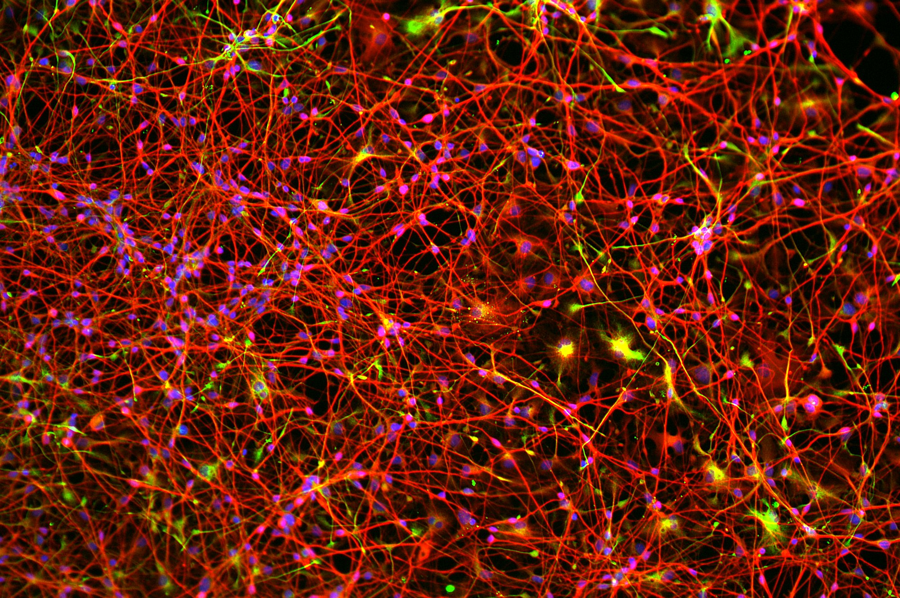

# DLFluoresenceQuantifier

## Authors & Collaborators
- **Davide Lattanzi** — Lead Developer (University of Urbino Carlo Bo)
- **Stefano Sartini** — Collaborator (University of Urbino Carlo Bo)
- **Ludovica Montesi** — Collaborator (University of Urbino Carlo Bo)
- **Alice Sartini** — Collaborator (University of Urbino Carlo Bo)
- **Giulia Api** — Collaborator (University of Urbino Carlo Bo)
- **Irene Zanchini** — Collaborator (University of Urbino Carlo Bo)
- **Riham Osman** — Collaborator (University of Urbino Carlo Bo)
- **Sara Salucci** — Collaborator (University of Bologna)
- **Rossana Rauti** — Collaborator (University of Urbino Carlo Bo)

**DLFluoresenceQuantifier** is a Python desktop application for quantitative fluorescence and brightfield microscopy image analysis, AI-assisted nuclear segmentation, colocalization measurement, and automated Excel reporting.



## Key Features
- **Multi-Format Microscopy Import:** Direct extraction of Leica `.lif` series, multichannel stacks (8/12/16-bit), and separate single-channel merges (Fluorescence + Brightfield).
- **Raw Bit-Depth Quantification:** Computes **Area %**, **Mean Pixel Intensity**, **Integrated Density (IntDen)**, and **CTCF** directly on untouched raw detector pixel values with automatic saturation alerts.
- **Spatial ROIs & Artifact Exclusion:** Interactive Circle/Ellipse and Freehand Polygon tools to target specific regions and exclude debris or folding artifacts.
- **Morpho-Template Nuclei AI & Watershed:** Learns nuclear chromatin granularity, Hessian blob geometry, and visual templates (Fluorescence & Brightfield) with Area and Circularity filters, plus reusable `.aim` model files.
- **Independent Per-Channel Thresholds:** Separate session-locked thresholds for Red, Green, and Blue channels with real-time Magenta overlay preview.
- **Colocalization / Double-Labeling:** Computes Double-Positive Area %, Manders' **M1 / M2** coefficients, **Pearson's *r***, and double-positive nuclei counts with Cyan preview.
- **Session Persistence & Excel Reporting:** Full project save/reload (`.cfq`) and formatted multi-sheet Excel export (`.xlsx`) including a built-in Parameter & Formula Guide.

## Installation & Usage (from Source)
1. Install the required dependencies:
   ```bash
   pip install -r requirements.txt
